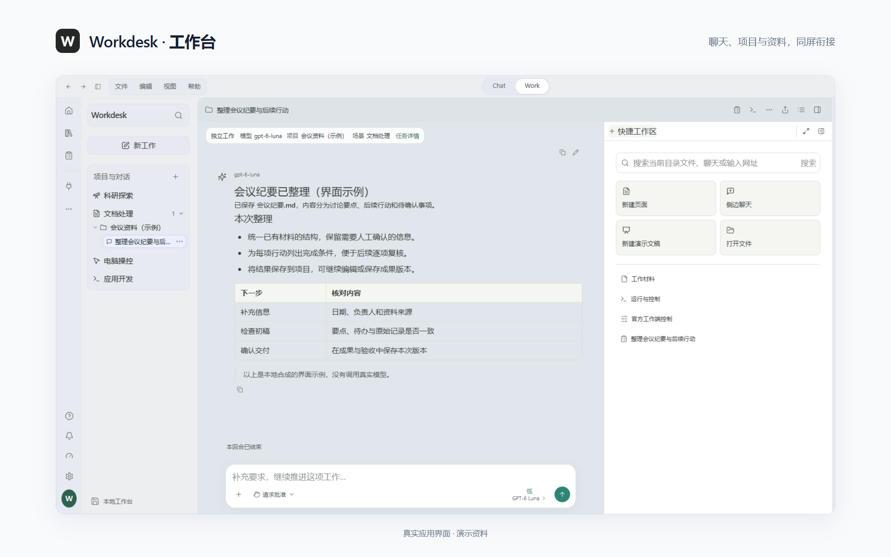
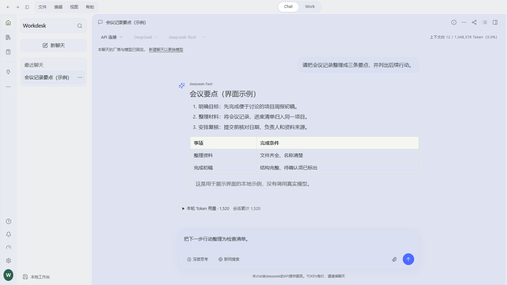
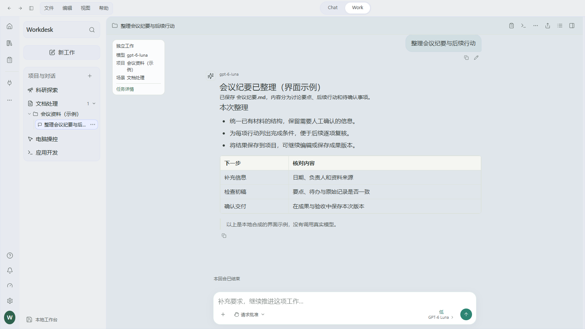
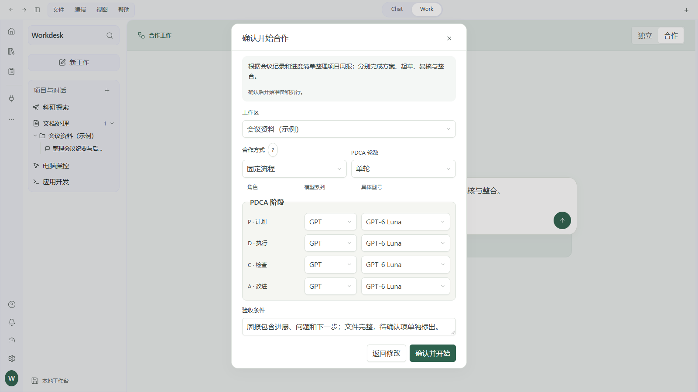
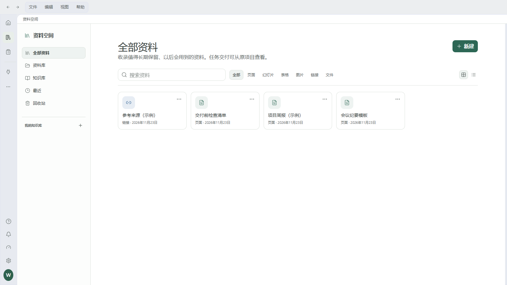
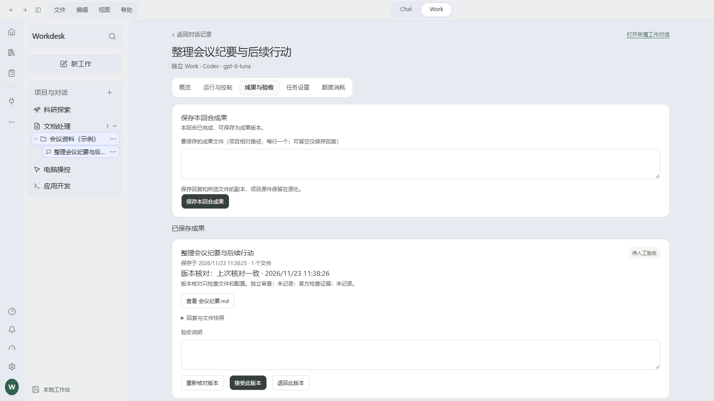
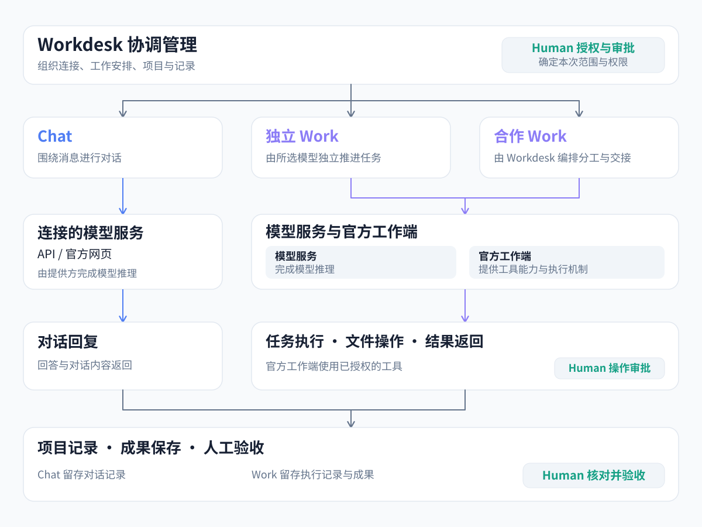

<p align="center">
  
</p>

<h1 align="center">Workdesk · 工作台</h1>

<p align="center"><strong>一个工作空间，连接不同的 AI 能力。</strong></p>

<p align="center">面向 Windows 的本地 AI 工作台，让聊天、项目执行、多模型协作与成果管理自然衔接。</p>

<p align="center">
  <a href="https://github.com/hanamai0930/Workdesk/releases/tag/v1.0.0"></a>
  <a href="docs/DEVELOPMENT.md"></a>
  <a href="LICENSE"></a>
  <a href="#认识-workdesk"></a>
</p>

<p align="center">
  <a href="https://github.com/hanamai0930/Workdesk/releases/tag/v1.0.0">Windows 安装包</a> ·
  <a href="#快速开始">从源码运行</a> ·
  <a href="docs/USER_GUIDE.md">用户指南</a>
</p>



截图来自实际应用界面，使用独立演示资料。对话正文和任务回执为操作示例，素材来源见[图片说明](docs/assets/README.md)。

## 认识 Workdesk

Workdesk 把 AI 聊天、项目任务、模型分工和资料整理放进同一个工作空间。讨论目标、连接工作端、查看执行过程，再把回复和文件保存为可验收的成果，工作可以围绕同一个项目持续展开。

当一项任务需要反复查资料、改文件、请不同模型分工时，Workdesk 将这些步骤组织在项目、对话和合作流程中。你可以追踪每一回合、核对实际文件，并决定成果是否通过验收。

Workdesk 复用已有模型服务与官方工作端。模型推理和原生工具执行由所连接的服务及工作端负责，Workdesk 专注于项目组织、接口衔接、任务协调与成果验收。执行权限由你授权，关键操作可以审批，成果由你确认。

## 核心功能

### Chat · 日常对话与资料阅读

带着问题和材料开始讨论，在原对话里继续推进。

- 使用自己的 DeepSeek、Qwen API Key 聊天。
- 在桌面视图打开厂商官方网页。
- 添加附件，阅读回复，继续提问或保留草稿。
- 搜索、整理和归档历史对话。



### Independent Work · 独立完成项目任务

选择一个官方工作端，让它在指定项目中读写文件、运行工具并交回成果。

- 连接 Codex、DeepSeek Harness、Qwen Code 等当前支持的工作端。
- 选择项目、型号和访问权限，按目标持续工作。
- 按工作端支持的能力使用计划模式、Skills 和 MCP。
- 查看回合、处理审批、停止或接续任务。



### Collaboration · 多模型分工与合作流程

把复杂目标拆成有分工、有阶段、可检查的合作任务。

- 选择固定流程、负责人带队或主持人—专家。
- 核对角色、型号、PDCA 轮数和本次授权。
- 查看执行纪要、阶段轨迹、回合与用量。
- 根据中间结果调整下一步，保存成果并验收。



### Workspace · 项目资料、文档与成果

把工作需要的资料和工作产生的成果，放回可查找的项目与资料空间。

- 整理文件、链接、页面和知识库。
- 在右栏编辑 Markdown 页面、整理演示文稿并预览文件。
- 关联项目、执行记录和成果版本。
- 保存验收决定，导出备份或恢复资料库。



## 合作如何推进

合作方式决定谁来安排工作、谁来执行、怎样汇总。可以根据目标清晰程度和所需分工选择。

| 合作方式 | 适合的任务 | 推进方式 |
| --- | --- | --- |
| 固定流程 | 步骤清楚、可以重复的工作 | 按核对后的方案依次推进各阶段 |
| 负责人带队 | 需要统一安排和汇总的项目 | 先讨论需求，由负责人协调分工 |
| 主持人—专家 | 需要多个方向参与和判断的问题 | 先讨论需求，由主持人组织专家意见与后续工作 |

**Plan 规划 → Do 执行 → Check 检查 → Act 改进与整理交付**

1. **规划**目标、材料、角色分工和完成要求。
2. **执行**已授权的任务，保留工作端回合与执行记录。
3. **检查**阶段结果和交付文件，核对是否达到完成要求。
4. **改进**遗漏和问题，整理成果，交由你验收或继续下一轮。

阶段记录帮助你追踪工作和定位问题。最终质量通过实际文件核对与人工验收确认。



## 工作方式

Workdesk 组织对话和任务。Chat 通过模型服务返回回复，Work 通过官方工作端处理项目文件与工具，过程和成果回到工作台供你查看、审批与验收。



## 适用场景

| 场景 | 可以怎样用 |
| --- | --- |
| 个人开发与项目管理 | 讨论方案、修改代码、整理文档，把回合记录与项目成果放在一起 |
| 科研项目和实验工作 | 整理文献与实验材料、编写脚本、记录检查过程和待确认问题 |
| 多模型协作与复杂任务组织 | 根据角色安排不同工作端，跟踪阶段进度，汇总并验收交付 |

## 快速开始

准备 **Windows 11 x64、Python 3.12、Node.js 22 和 pnpm 11**。取得源码后，在项目根目录运行以下命令。命令与[开发说明](docs/DEVELOPMENT.md)一致。

```powershell
py -3.12 -m venv .venv
.\.venv\Scripts\python.exe -m pip install -e .
pnpm --dir workdesk-ui install --frozen-lockfile
pnpm --dir workdesk-ui run build
Remove-Item Env:WORKDESK_DATA_DIR -ErrorAction SilentlyContinue
$env:WORKDESK_HOME = Join-Path (Get-Location) '.workdesk-dev'
.\.venv\Scripts\python.exe .\workdesk-ui\server.py --open
```

首次启动打开本地界面，在连接页保存自己的 API Key。新建开发资料默认写入 `.workdesk-dev`，实际位置可在设置中核对，项目原件保存在你选择的文件夹。官网内嵌视图、官方工作端和额度查询所需组件，按[开发说明中的准备步骤](docs/DEVELOPMENT.md#可选的桌面与工作端组件)配置。

## 文档入口

| 文档 | 内容 |
| --- | --- |
| [用户指南](docs/USER_GUIDE.md) | 账号连接、Chat、独立与合作 Work、资料管理、备份恢复 |
| [开发说明](docs/DEVELOPMENT.md) | 源码运行、桌面与工作端组件、本地检查 |
| [MIT 许可证](LICENSE) | Workdesk 自有源码和文档的使用许可 |
| [第三方声明](THIRD_PARTY_NOTICES.md) | 第三方组件的许可与使用范围 |

## 项目状态

- 当前主要支持 **Windows 11 x64**，仓库公开提供源码。
- **Windows 安装版 `v1.0.0` 已发布**，下载和安装说明见[发行页](https://github.com/hanamai0930/Workdesk/releases/tag/v1.0.0)。安装包随附离线指南，当前未签名。
- 从源码运行时，官方工作端、桌面宿主及部分运行组件需要独立准备。实际模型和工具能力取决于连接的服务、组件版本及授权。
- 使用模型、官网与外部工具时，相关请求由选中的提供方处理，费用按提供方规则结算。

遇到问题，欢迎提交 [GitHub Issue](https://github.com/hanamai0930/Workdesk/issues)，附上 Windows 版本、复现步骤和错误提示。提交前请移除密钥、账号信息与私有项目内容。

## 许可证

Workdesk 自有源码和文档采用 [MIT License](LICENSE)。第三方内容按各自许可使用，详见[第三方声明](THIRD_PARTY_NOTICES.md)。
